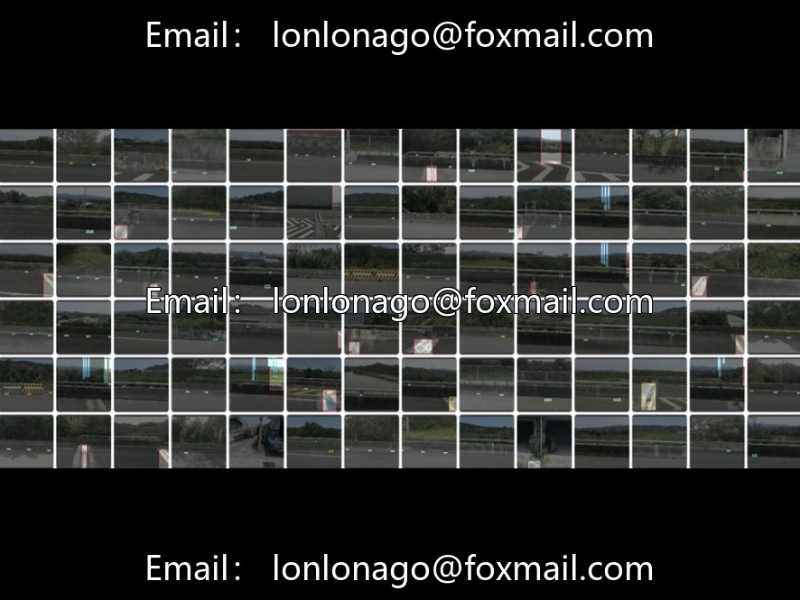
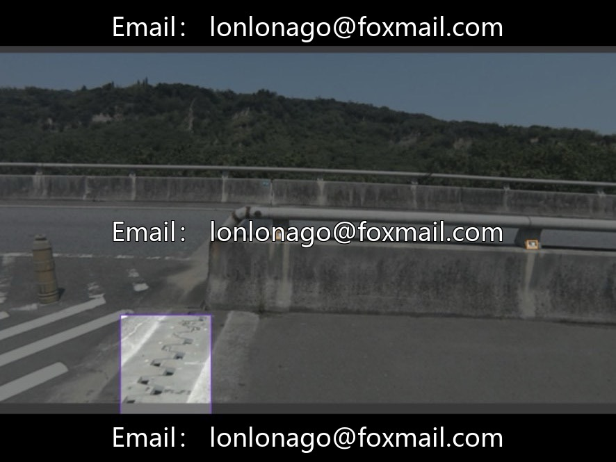
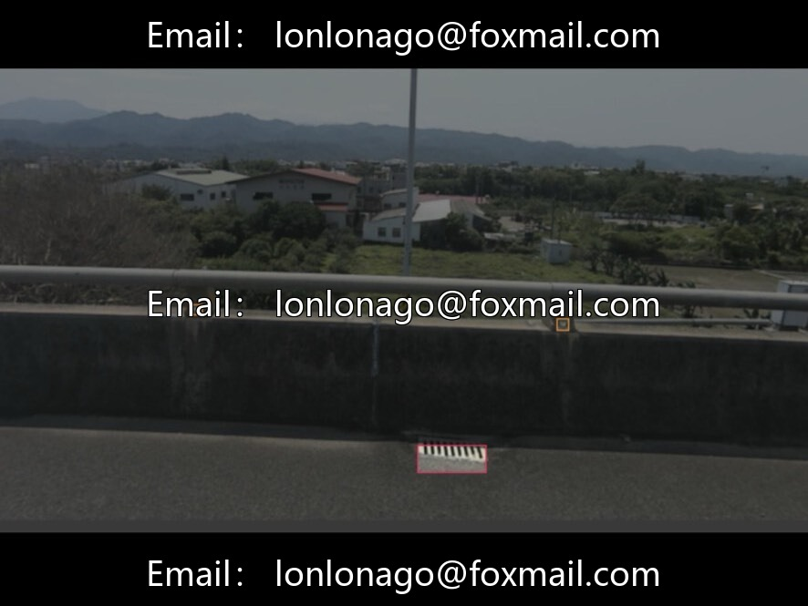
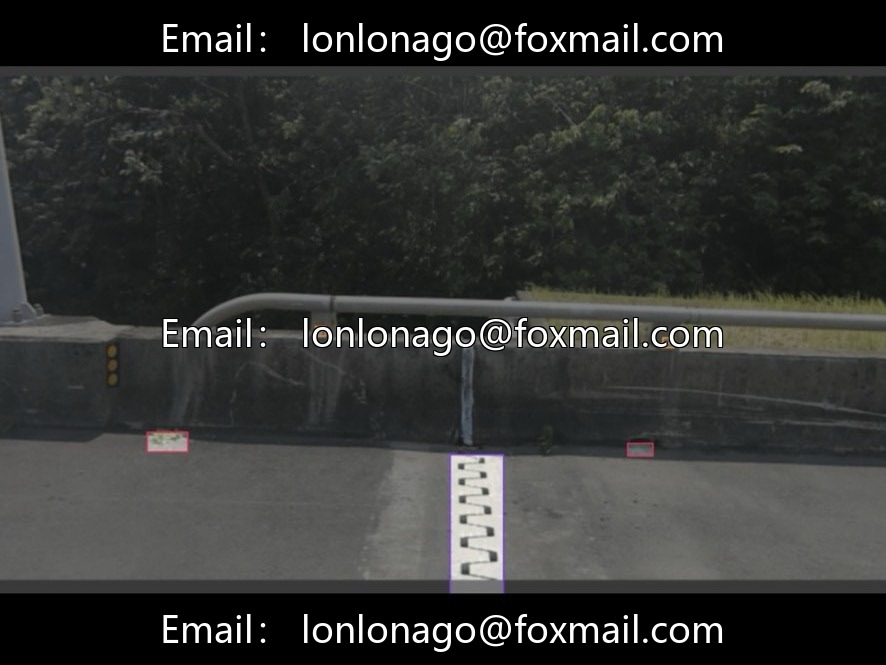
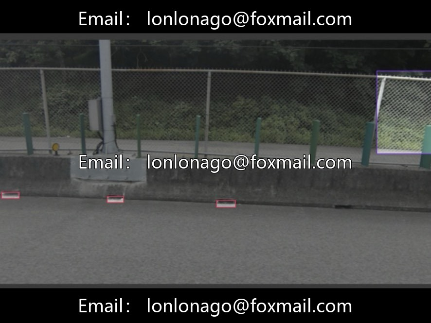

# Bridge Component Defects YOLO Dataset | Civil Engineering/Drone Inspection Project Materials 1077

## Body

Bridge Component Defects YOLO Dataset | Civil Engineering/Drone Inspection Project Materials Issue 10770 Edition

Road bridge appearance defect target detection dataset, intelligent inspection algorithm directly trained✅

Core Parameters Quick Overview

▪️ Total number of images: 4898 road/municipal bridge actual photos
▪️ Annotation categories: 7 types (bridge links, guardrails, drainage, fasteners, various diseases and so on)
▪️ Complex working conditions: backlighting, vegetation obstruction, distant minor diseases, mixed components
▪️ Compatible formats: YOLO / VOC / COCO, discarding invalid samples obscured by blurriness.
▪️ Baseline model: mAP@50=69.8%, precision=65.8%, recall=68.7%
▪️ Supported resources: 26-round complete training and inference code for YOLOv8, with its own yaml configuration file

Data set advantages

Cover the mainstream bearing members of bridges and common appearance diseases; Adapted for the identification of minor defects at a distance, with clean labeling that does not require secondary cleaning. Lightweight models for edge device deployment

Four major ground applications

1. Drone bridge inspection for high-altitude, replacing human hazardous detection.
2. Automated positioning of cracks, rust, and flaking points on vehicle/handheld bridge inspection equipment
3. Regular structural health assessment of bridges, digital operation and maintenance archives
4. Automatic statistical of highway infrastructure diseases, reducing maintenance manpower costs

Adaptation direction

Smart Bridges, Drone Inspection, Industrial Defect Detection, Civil Engineering Interdisciplinary Projects, YOLO Object Detection Algorithm Development

Virtual materials, once sold, are non-refundable.
Interested friends, click "I want" to proceed.

## Images

## Payment

Here is a pay link on Stripe ( https://buy.stripe.com/3cs8yP7sY87d0vu9AB ). Please contact me lonlonago@foxmail.com after funding $89, and I will send you a complete data files , thank you!

